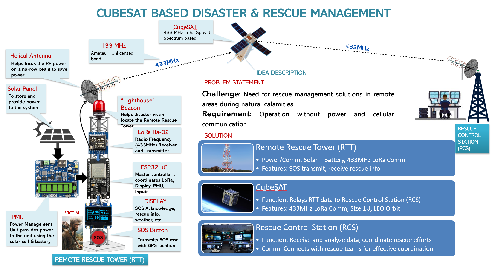
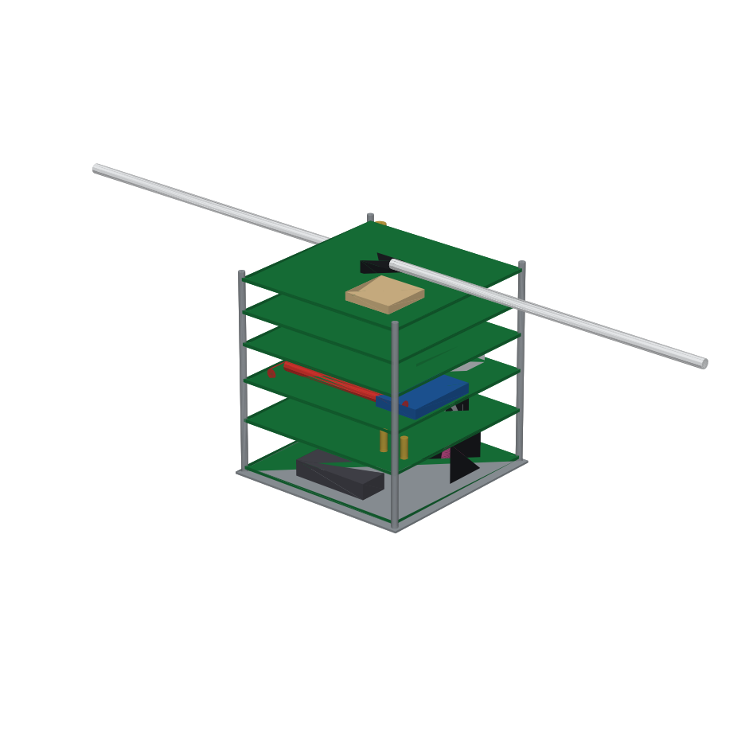
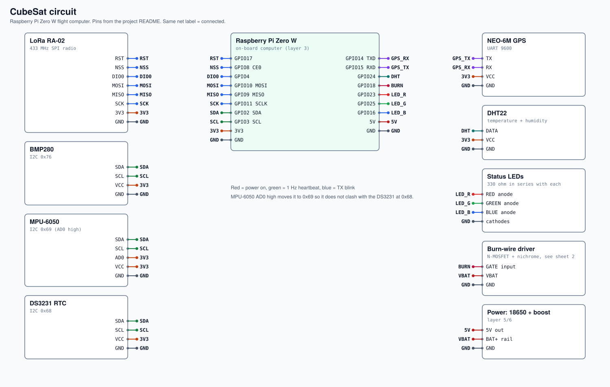
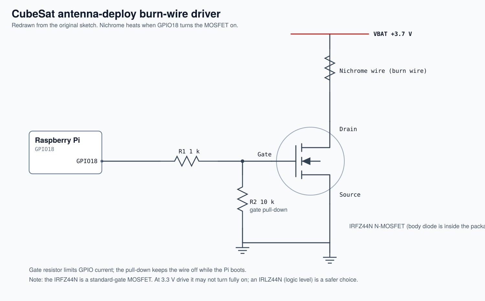
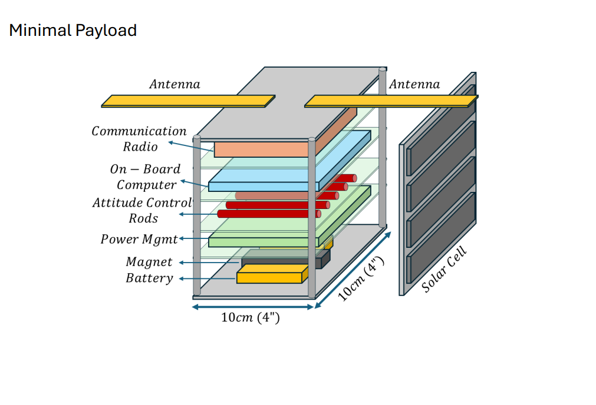
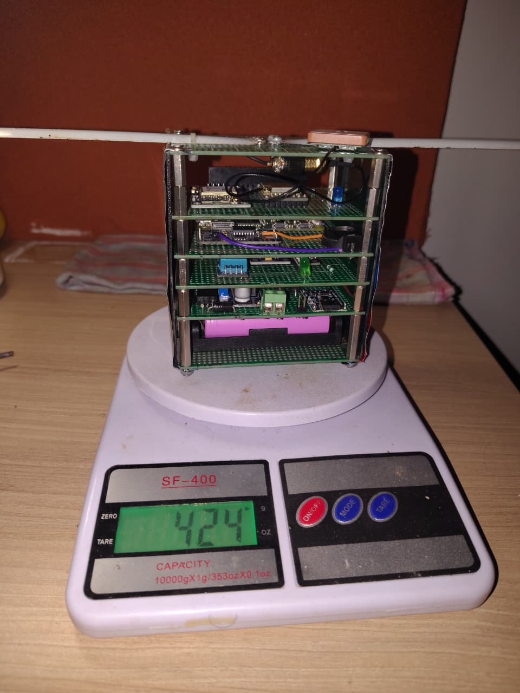
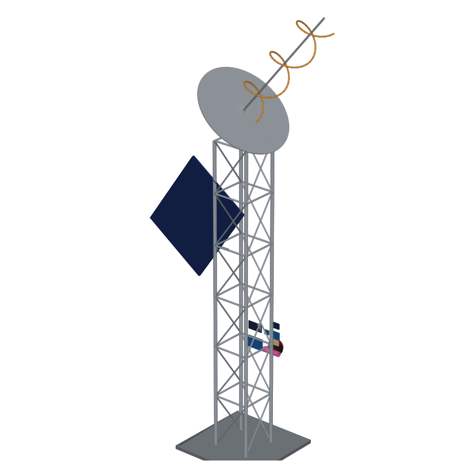
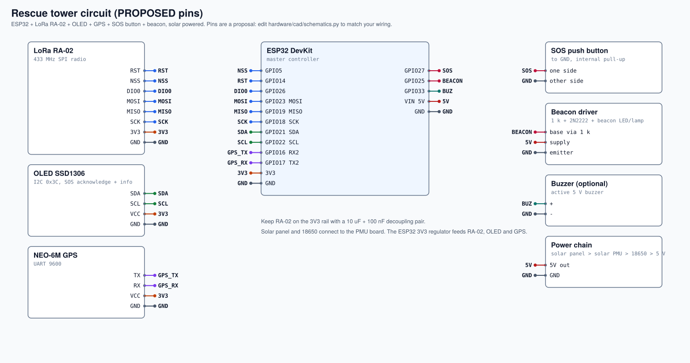
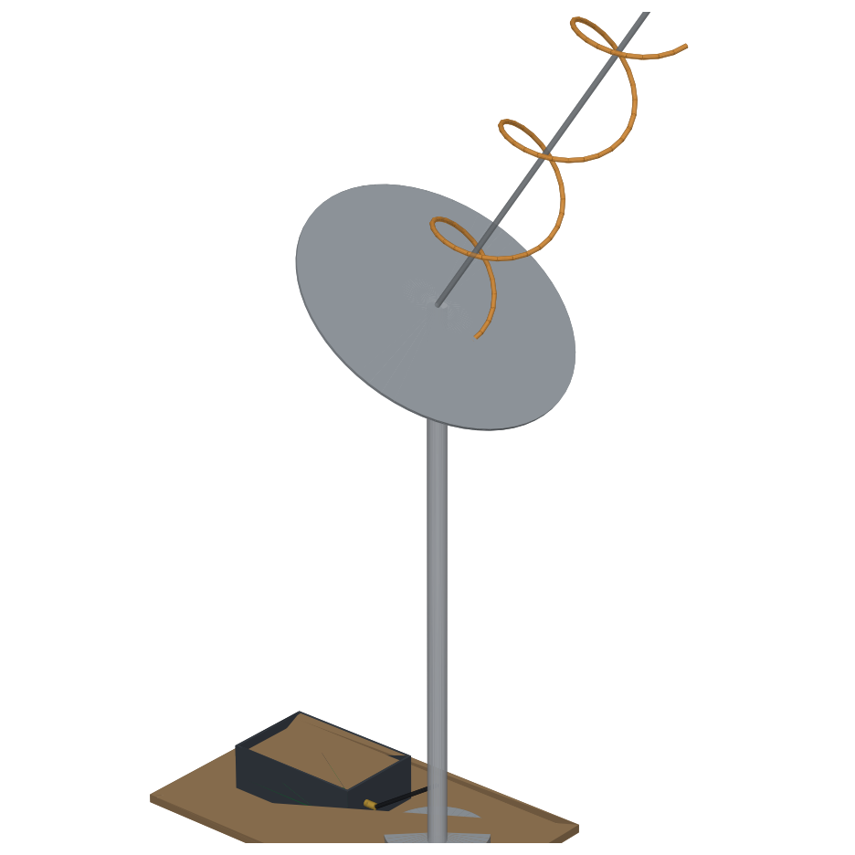
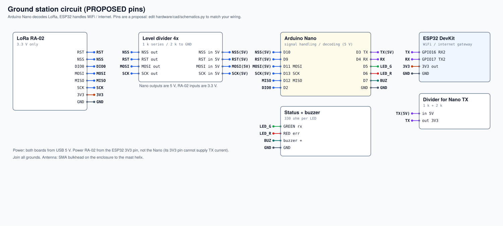

# Cubesat_Prototype hardware: circuits and 3D models

Circuit diagrams, 3D models and printable parts for the CubeSat rescue network: **rescue tower**, **CubeSat relay** and **ground station**, all talking over 433 MHz LoRa (RA-02).

**Interactive viewer:** open [`viewer/index.html`](viewer/index.html) in a browser. It has exploded 3D views and the circuit diagrams for all three devices. Turn on GitHub Pages for the `viewer/` folder to get a public link.

> The CubeSat pin maps come from the project README. The **rescue tower and ground station pins are proposed**, because they were not documented. Check them against your build and edit `hardware/cad/schematics.py` where they differ. The 3D models are illustrative: dimensions marked as assumed in `hardware/cad/build_models.py` should be replaced with measurements.

## Abstract

A victim presses the SOS button on a solar-powered **rescue tower**. The tower sends the SOS and GPS position over 433 MHz LoRa to a **CubeSat** in LEO, which relays it to a **ground station** (rescue control station) that decodes it and passes it on to rescue teams.



## Repository layout

```
viewer/                    index.html  interactive 3D models + circuits (self-contained)
hardware/
  cubesat/                 circuit.svg/png, burnwire.svg/png, pinmap.csv, cubesat.glb/.stl, preview
  rescue_tower/            circuit.svg/png, pinmap.csv, rescue_tower.glb/.stl, preview
  ground_station/          circuit.svg/png, pinmap.csv, ground_station.glb/.stl, preview
  printable/               STL files ready for a slicer
  cad/                     build_models.py, schematics.py, preview.py, build_viewer.py
docs/images/               project photos and diagrams
build_all.sh               regenerate everything
```

## 1. CubeSat

Raspberry Pi Zero W flight computer, LoRa RA-02, BMP280, MPU-6050, DS3231 RTC, NEO-6M GPS, DHT22, status LEDs and a MOSFET burn-wire driver that releases the antenna. 100 x 100 x 100 mm, six layers on four corner rods.





| Layer | Contents |
|---|---|
| 1 | Antenna (433 MHz dipole), GPS patch |
| 2 | Communication radio (RA-02) |
| 3 | On-board computer (Raspberry Pi Zero W) |
| 4 | Attitude control rods and sensors (MPU-6050, BMP280, DHT22, DS3231, status LEDs) |
| 5 | Power management and antenna deployment (boost board, MOSFET, burn wire) |
| 6 | Magnet and battery (18650) |

### Pin configuration (Raspberry Pi Zero W)

| Module | Pin | Pi GPIO |
|---|---|---|
| RA-02 | RST / CS(NSS) / DIO0 | 17 / 8 (CE0) / 4 |
| RA-02 | MOSI / MISO / SCK | 10 / 9 / 11 |
| BMP280 (0x76), MPU-6050 (0x69), DS3231 (0x68) | SDA / SCL | 2 / 3 |
| NEO-6M | TX to Pi RX / RX to Pi TX | 15 / 14 |
| DHT22 | DATA | 24 |
| Burn-wire MOSFET | GATE | 18 |
| LEDs (330 ohm each) | Red (power) / Green (1 Hz run) / Blue (TX) | 23 / 25 / 16 |

All sensors and the radio run from 3.3 V. MPU-6050 AD0 must be pulled high (address 0x69) so it does not clash with the DS3231 at 0x68.

### Antenna deploy circuit



GPIO18 drives the gate through R1 = 1 k, with R2 = 10 k pulling the gate down. The IRFZ44N is not a logic-level MOSFET, so at 3.3 V gate drive it may not turn fully on. An IRLZ44N is a safer choice. The original sketch is in [`docs/images/burnwire_circuit_original.png`](docs/images/burnwire_circuit_original.png).

### Photos and reference





The scale photo reads 424 g. The earlier README text lists 1.33 kg, so one of the two needs correcting.

## 2. Rescue tower

ESP32 with LoRa RA-02, OLED display for SOS acknowledgement, NEO-6M GPS, SOS button, red lighthouse beacon and a solar panel with PMU and 18650. Helical antenna on a dish at the top points at the satellite.





### Pin configuration (ESP32 DevKit, proposed)

| Module | Pin | ESP32 GPIO |
|---|---|---|
| RA-02 | NSS / RST / DIO0 | 5 / 14 / 26 |
| RA-02 | MOSI / MISO / SCK | 23 / 19 / 18 |
| OLED SSD1306 (0x3C) | SDA / SCL | 21 / 22 |
| NEO-6M | TX to ESP RX2 / RX to ESP TX2 | 16 / 17 |
| SOS button (to GND, pull-up) | | 27 |
| Beacon (1 k + 2N2222) | | 25 |
| Buzzer (optional) | | 33 |

## 3. Ground station

Arduino Nano decodes the LoRa packets and hands them to an ESP32 over serial for WiFi and internet. The RA-02 is 3.3 V only, so the Nano's 5 V outputs (NSS, RST, MOSI, SCK) go through 1 k / 2 k dividers, and the RA-02 is powered from the ESP32 3V3 pin.





### Pin configuration (proposed)

| Signal | Arduino Nano | Notes |
|---|---|---|
| RA-02 NSS / RST / MOSI / SCK | D10 / D9 / D11 / D13 | through 1 k / 2 k dividers |
| RA-02 MISO / DIO0 | D12 / D2 | 3.3 V into Nano is fine |
| Nano to ESP32 | D3 TX to ESP32 GPIO16 | divider on this line |
| ESP32 to Nano | ESP32 GPIO17 to D4 RX | direct |
| Green / red LED, buzzer | D5 / D6 / D7 | 330 ohm per LED |

## 3D printable parts

In [`hardware/printable/`](hardware/printable):

| File | Use |
|---|---|
| `ground_station_enclosure_base.stl`, `_lid.stl` | 170 x 110 x 55 mm box with SMA, USB and LED cutouts |
| `rescue_tower_enclosure_base.stl`, `_lid.stl` | 150 x 90 x 190 mm box with OLED window and SOS button hole |
| `cubesat_board_spacer_18mm.stl` | 18 mm spacer, print 20 or more |
| `cubesat_dipole_clamp.stl` | clamp for the antenna rod |

Check the cutout positions against your actual modules before printing.

## Regenerate

```bash
./build_all.sh      # models, schematics, previews, viewer
```

## License

MIT, see [LICENSE](LICENSE).
